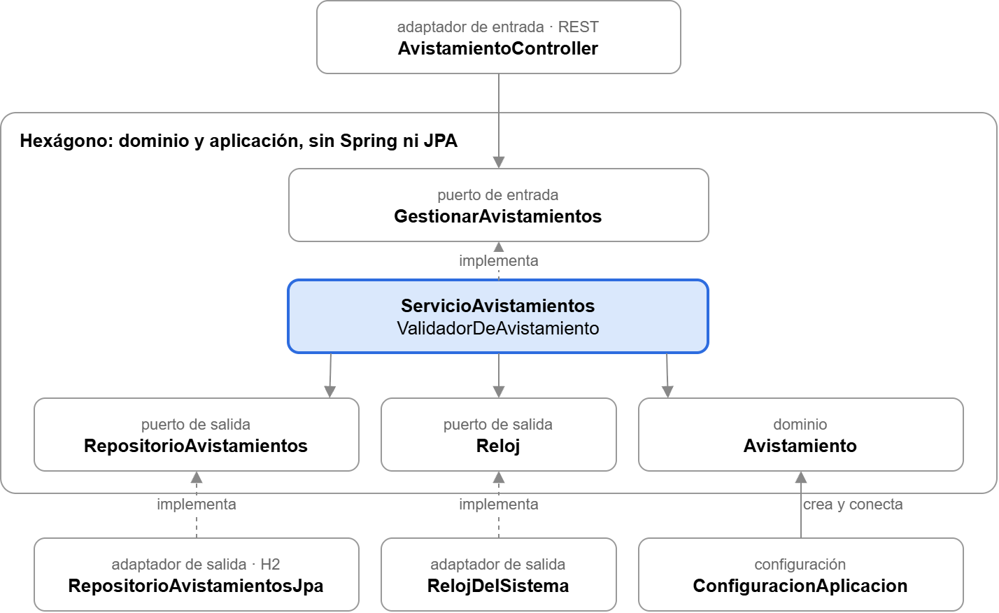
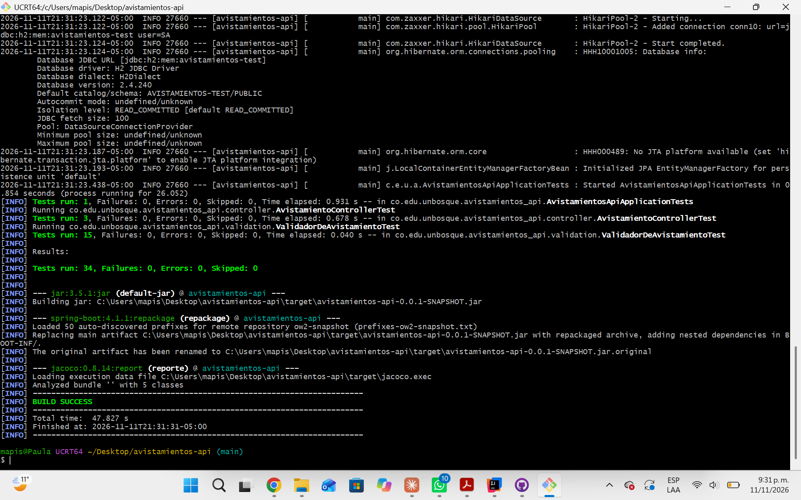
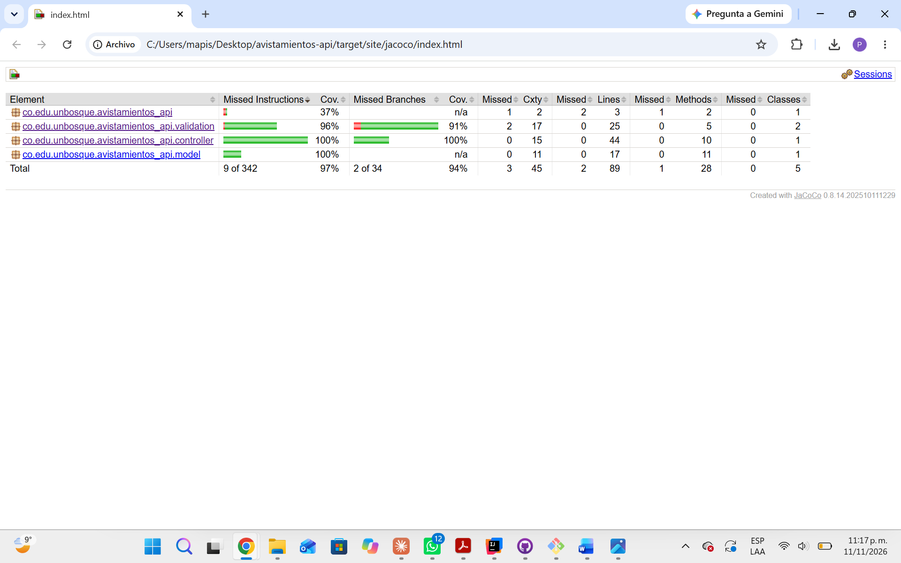
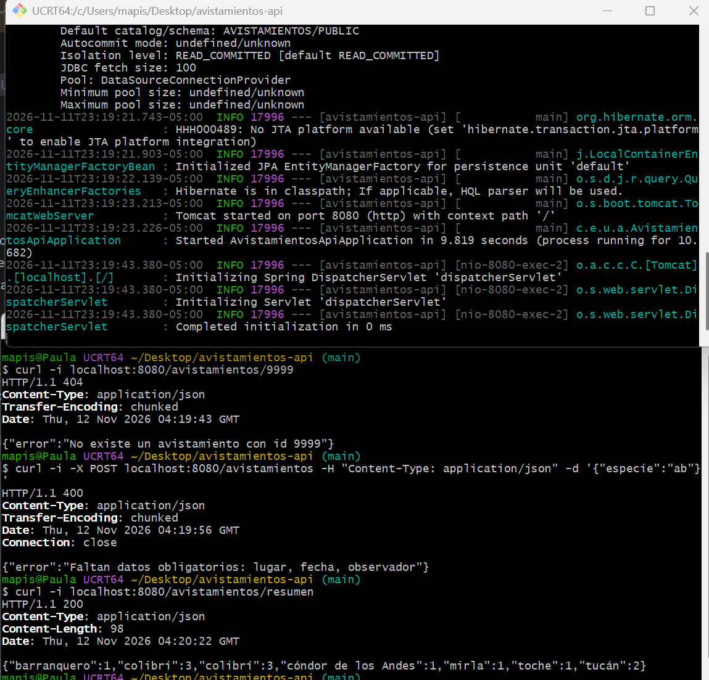
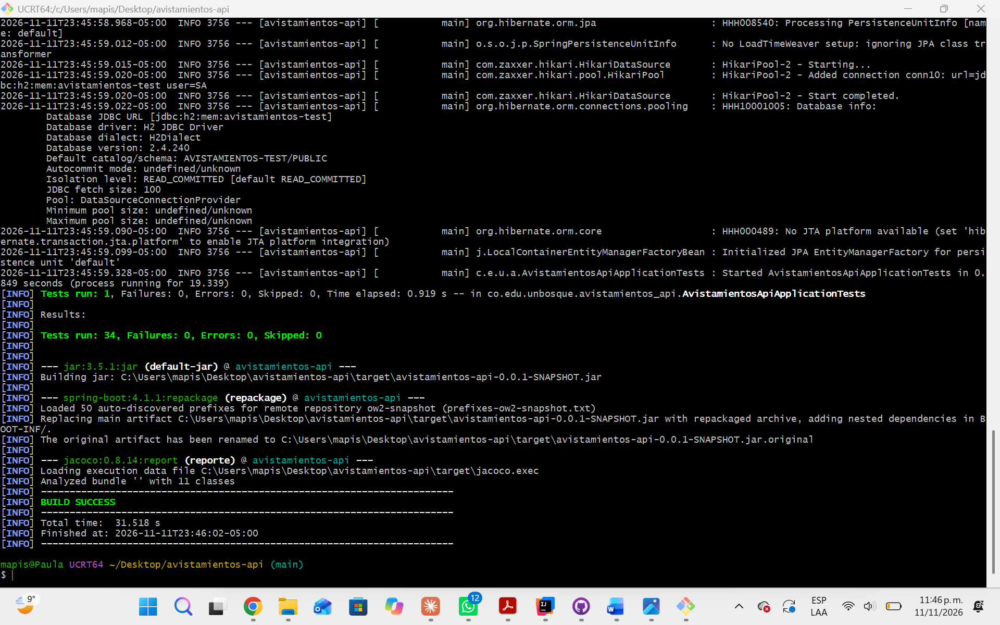
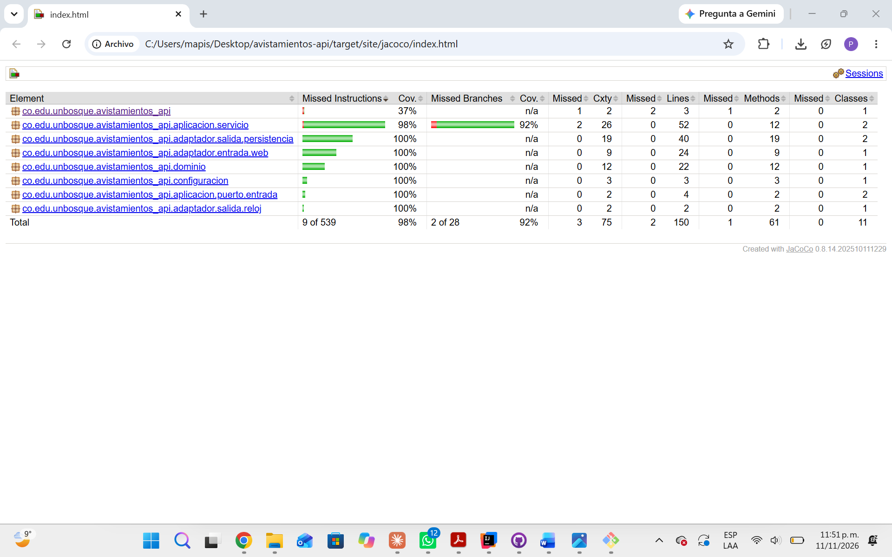
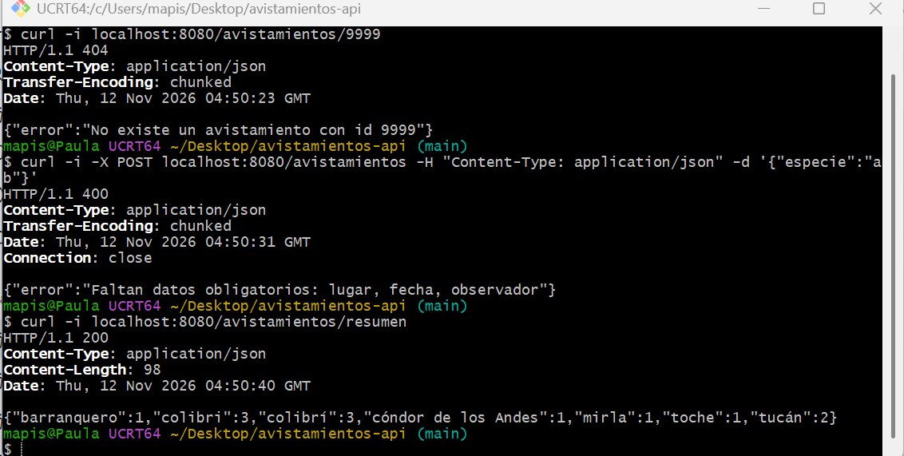

# Taller: Clean Architecture

**Ingeniería de Software 2** - María Paula Marín Soler

---

## Parte 1. Investigación

### 1. Cockburn (2005) parte de un problema que ve en las aplicaciones de su época.

**¿Cuál es ese problema?**

El problema del que parte Cockburn es que la lógica de negocio se mezcla con la interfaz de usuario y con la base de datos. Esto ocasiona que la aplicación no se pueda probar de manera automática, ni se pueda cambiar de interfaz o base de datos sin tocar la lógica de negocio (Cockburn, 2005).

**¿Qué es un puerto y qué es un adaptador en su propuesta?**

Un puerto es una interfaz que define la aplicación para comunicarse con el exterior, como "registrar avistamiento" o "guardar avistamiento". Un adaptador traduce una tecnología concreta (REST, SQL, pruebas) a ese puerto, y un mismo puerto puede tener varios adaptadores (Cockburn, 2005).

**¿Por qué dice que hay una simetría entre el lado del usuario y el lado de la base de datos?**

Hay simetría porque el usuario y la base de datos son lo mismo, es decir, cosas externas que hablan con la aplicación por medio de un puerto. La única diferencia es quién inicia la conversación, por ejemplo, al usuario lo llama actor primario y a la base de datos, actor secundario (Cockburn, 2005).

### 2. Martin (2012) dibuja Clean Architecture como círculos concéntricos.

**¿Qué va en cada círculo?**

Lo que va en el círculo de adentro hacia afuera, según Martin (2012), son:

- **Entidades:** Las reglas de negocio generales.
- **Casos de uso:** Las reglas de la aplicación.
- **Adaptadores de interfaz:** Controladores, presentadores y gateways.
- **Frameworks y drivers:** La web, la base de datos y las herramientas externas.

**Martin enuncia una sola regla para todo el diagrama, la regla de dependencia (The Dependency Rule): ¿qué dice esa regla sobre la dirección en que puede apuntar el código, y qué prohíbe?**

La regla de dependencia dice que el código solo puede depender hacia adentro. Prohíbe que un círculo interno mencione cualquier cosa de uno externo, sean clases, funciones o formatos de datos (Martin, 2012).

### 3. Según la regla anterior, el caso de uso no puede depender de la base de datos. Pero el caso de uso necesita guardar datos.

**¿Cómo resuelve Clean Architecture esa contradicción? Expliquen el mecanismo con un ejemplo (Martin lo trata en el mismo artículo, y también sirve el principio de inversión de dependencias que vieron en SOLID).**

Clean Architecture lo resuelve con inversión de dependencias. El caso de uso define una interfaz, por ejemplo, `RepositorioAvistamientos.guardar()`, y solo conoce esa interfaz. Afuera, un adaptador SQL la implementa, y al arrancar la aplicación se le entrega esa implementación al caso de uso (Martin, 2012). De esta manera, en ejecución el control va hacia la base de datos, pero en el código la dependencia apunta hacia adentro. En las pruebas se puede usar un repositorio en memoria en lugar del real.

### 4. Comparen la arquitectura hexagonal (Cockburn, 2005), la de cebolla (Palermo, 2008) y Clean Architecture (Martin, 2012).

**¿Qué tienen en común las tres?**

Las tres arquitecturas tienen en común que el negocio va en el centro y no depende de la infraestructura, las dependencias apuntan hacia adentro, y el centro define interfaces que el exterior implementa (Cockburn, 2005, Palermo, 2008, Martin, 2012). Martin dice que Clean Architecture integra a las otras dos (Martin, 2012).

**¿Qué cambia de una a otra: el vocabulario, el número de capas, ¿algo más?**

Lo que cambia una arquitectura a otra es:

- **Vocabulario:** Puertos y adaptadores en la hexagonal, capas de dominio en la cebolla, entidades y casos de uso en Clean.
- **Número de capas:** La hexagonal solo distingue adentro y afuera, la cebolla divide el núcleo en varias capas, Clean propone cuatro círculos.
- **Énfasis:** La hexagonal se centra en la frontera, la cebolla en el núcleo y Clean en una sola regla.

### 5. Su API es pequeña: unos pocos endpoints y una regla de validación.

**¿Se justifica aplicarle Clean Architecture? Argumenten con al menos un costo (trade-off) y un beneficio concreto, y tomen una posición. No hay una única respuesta correcta: se califica el argumento.**

**Costo:** Muchos más archivos e indirección para un CRUD con una sola regla de validación. Palermo dice que su arquitectura no es apropiada para sitios pequeños (Palermo, 2008).

**Beneficio:** La validación se prueba sin base de datos ni framework, y la tecnología se puede cambiar sin tocar el negocio (Cockburn, 2005, Martin, 2012).

Por eso propongo separar solo el dominio, los casos de uso y los adaptadores, y crecer la estructura si la API crece.

---

## Parte 2. Aplicación

**Repositorio:** https://github.com/MarinMp/isw2-avistamientos-api
**Rama:** main

**Arquitectura elegida:** Arquitectura hexagonal (puertos y adaptadores). La elegí porque para una API pequeña es la más directa, ya que solo distingue el adentro, es decir, el dominio y aplicación, con sus puertos y el afuera distingue a los adaptadores. Usé su vocabulario de forma consistente, como puertos de entrada y de salida, y adaptadores de entrada y de salida.

### Estructura de carpetas

```
src/main/java/co/edu/unbosque/avistamientos_api/
├── dominio/
│   └── Avistamiento.java                   # objeto de negocio + normalizar()
├── aplicacion/
│   ├── puerto/
│   │   ├── entrada/                        # GestionarAvistamientos + 2 excepciones
│   │   └── salida/                         # RepositorioAvistamientos, Reloj
│   └── servicio/                           # ServicioAvistamientos, ValidadorDeAvistamiento
├── adaptador/
│   ├── entrada/web/                        # AvistamientoController (REST)
│   └── salida/
│       ├── persistencia/                   # AvistamientoEntity, AvistamientoJpaRepository,
│       │                                   # RepositorioAvistamientosJpa
│       └── reloj/                          # RelojDelSistema
├── configuracion/                          # ConfiguracionAplicacion (conecta todo)
└── AvistamientosApiApplication.java
```

### Diagrama de dependencias



### Funcionamiento antes del refactor

**Pruebas unitarias y de integración:**



**Reporte de cobertura:**



**API:**



### Funcionamiento después del refactor

**Pruebas unitarias y de integración:**



**Reporte de cobertura:**



**API:**



### Lo más difícil de separar y por qué

Lo más difícil fue la clase Avistamiento, porque cumplía tres papeles a la vez. Era el objeto de negocio, la tabla de la base de datos y el JSON que entraba y salía del controlador. Para que el dominio no dependiera de JPA tuve que separarla en dominio.Avistamiento, sin anotaciones, y AvistamientoEntity en el adaptador de persistencia, con la conversión entre las dos en RepositorioAvistamientosJpa.

También costó sacar del controlador reglas como normalizar los datos, ignorar el id que llega y contar por especie, sin cambiar el comportamiento de la API. En PUT primero se revisa que el avistamiento exista y después que los datos sean válidos, y si ese orden cambiaba las pruebas de integración lo habrían detectado.

---

## Referencias

- Cockburn, A. (2005). *Hexagonal architecture*. https://alistair.cockburn.us/hexagonal-architecture/
- Martin, R. C. (2012). *The Clean Architecture*. The Clean Code Blog. https://blog.cleancoder.com/uncle-bob/2012/08/13/the-clean-architecture.html
- Palermo, J. (2008). *The Onion Architecture: part 1*. https://jeffreypalermo.com/2008/07/the-onion-architecture-part-1/
